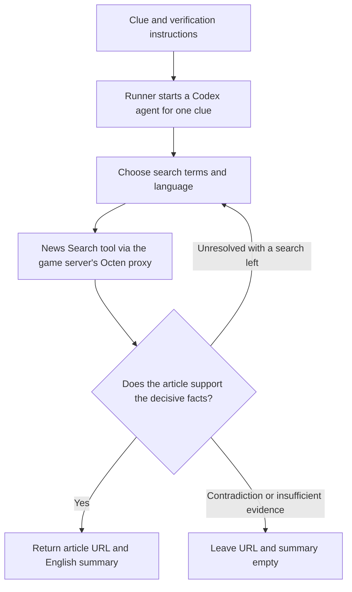
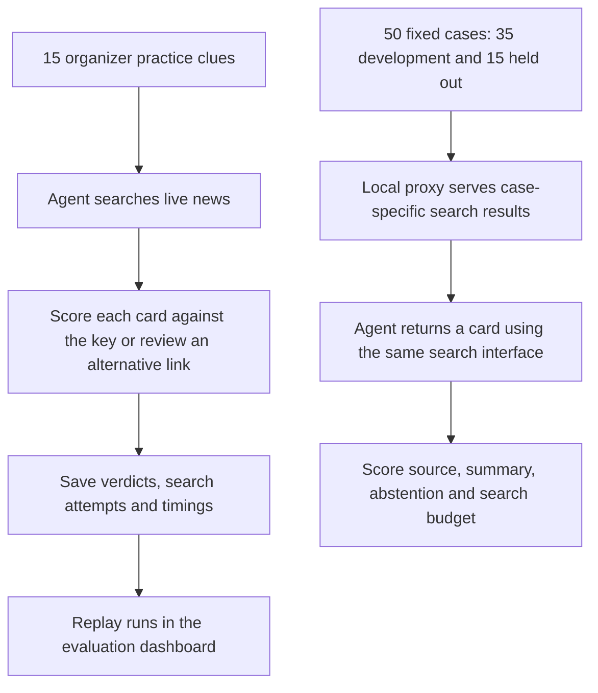

# Scoop Wars architecture

[Overview](README.md) · **Architecture** · [Practice results](README.md#what-changed-in-practice)

A clue describes a news event without naming the story. The agent has two searches and 45 seconds to find a source. An altered fact can make a plausible article the wrong answer, so the agent can return an empty card when the evidence conflicts.

## How a clue becomes an answer

The runner supplies the clue, the prompt and the JSON card schema. The agent chooses a query in English, Chinese or Indonesian. The search tool applies the publication window and can return bounded article text for up to four distinct results. When a headline leaves a key detail unresolved, the second query can use a name, location or local-language term learned from the first search. [Runner](play.py) · [Agent instructions](prompt.md) · [Search tool](news_search_mcp.py) · [Proxy client](octen_client.py) · [Card schema](card.schema.json)

**Why the verification step matters.** On an altered vaccine-study clue, the starter submitted a link even though its own summary identified a different group as the main beneficiaries. The revised agent checked the article, left the card blank and received full practice credit. [Case and result](README.md#four-clues-four-decisions) · [Case-level audit](outputs/showcase/practice-results.xlsx)

## How the agent is evaluated

**Live practice.** Replaying the same clues exposes variability in search results and agent decisions. The starter returned five wrong links. On three later runs the revised agent returned zero wrong links and scored 14/15, 14/15 and 13/15. A correct abstention counts as a correct answer on an altered clue. [Practice scoring](play.py) · [Judge for alternative links](judge.py) · [Evaluation dashboard](eval_ui.py)

**Fixed benchmark.** A local proxy serves authored evidence, with expected answers kept outside the agent input. This lets versions face the same cases and makes failures reproducible. The final version passed 48 of 50 automatic checks. Review accepted one valid currency notation that the scorer missed, bringing the reviewed score to 49 of 50. [Benchmark runner](tests/expanded_practice.py) · [Case definitions](tests/fixtures/expanded-practice.json) · [Evaluation protocol](docs/AI_WORKING_AGREEMENT.md) · [Recorded results](CONTEXT.md)
