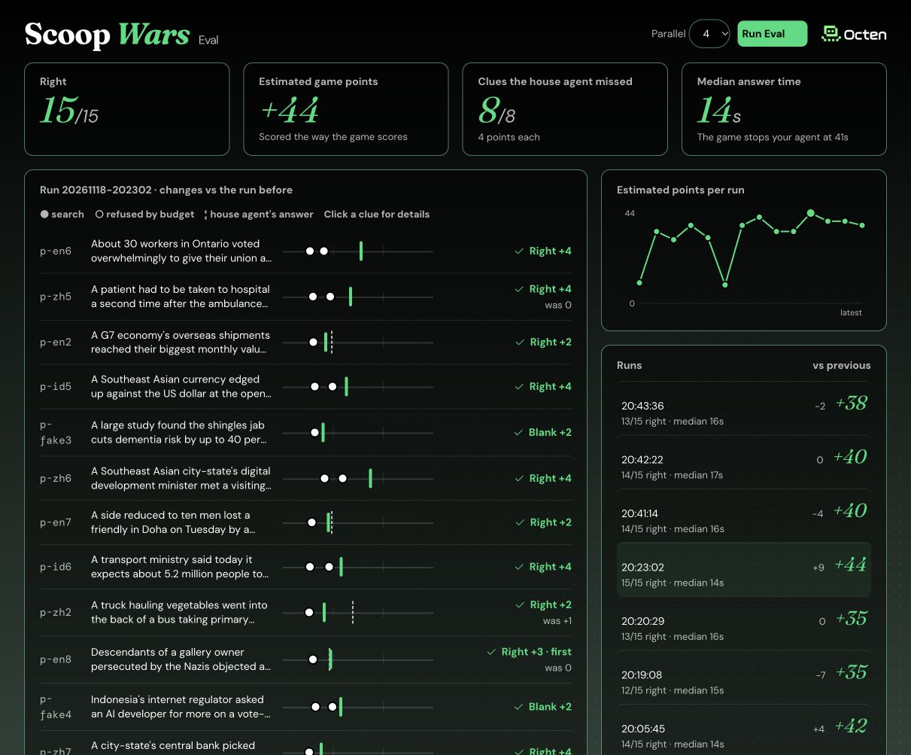

# Scoop Wars

Give the agent a clue with the headline and names stripped out. It has 45 seconds and two searches to find the original news story. Sometimes the clue changes one fact, and the winning move is to leave the card blank.

I adapted the organizers’ Codex agent to search in English, Chinese, and Indonesian, check the article behind a promising headline, and decide when the evidence warrants a link. On the same 15 practice clues, the starter earned **+10 points**. My version earned **+40, +40, and +38** in its final three runs, with **zero wrong links**. Its best recorded run got **15/15** in **14.1 seconds per clue at the median**.

[](docs/images/practice-dashboard.jpg)

*The organizers’ dashboard replaying the best run on November 18, 2026. Each dot marks a search. The run history on the right includes the three later repeats.*

## What changed in practice

All five runs below used the same organizer-provided clues and four concurrent workers. A correct answer means either a verified article or an intentionally empty card on a fake clue. Points are the practice scorer’s estimate under the game rules.

| November 18 practice run | Correct | Points | Wrong links | Successful searches | Median answer |
| --- | ---: | ---: | ---: | ---: | ---: |
| Starter | 8/15 | +10 | 5 | 30 | 14.4 s |
| Best recorded run | **15/15** | **+44** | 0 | 21 | **14.1 s** |
| Repeat 1 | 14/15 | +40 | 0 | 22 | 16.3 s |
| Repeat 2 | 14/15 | +40 | 0 | 23 | 16.7 s |
| Repeat 3 | 13/15 | +38 | 0 | 24 | 16.3 s |

The revision found all seven required local-language articles and correctly declined both fake clues in each of the four runs shown. The art-auction clue drew a blank in all three repeats. The Ontario strike clue drew a blank in the last one. Live search and model output varied between runs.

[Download the Excel audit with all 75 case results and submitted article links](outputs/showcase/practice-results.xlsx)

## Four clues, four decisions

These are cards from the +44 run. For articles outside the organizers’ answer key, the practice judge checked the event, publication window, and English summary.

| Clue | What the agent did | Result |
| --- | --- | --- |
| Singapore chip controls | The starter found the right meeting in English and lost points on the language rule. The revision returned 8world’s Chinese report on Josephine Teo and Jeffrey Kessler discussing how Singapore firms could retain access to AI chips. [8world](https://www.8world.com/singapore/josephine-teo-meeting-us-official-jeffrey-kessler-3344116) | +4 · 2 searches · 26.3 s |
| Ambulance struck overnight | The clue gave the driver’s age and omitted the country. After an English search, a Chinese retry found the Fengshan crash and the transfer of the patient to a second ambulance. The judge accepted the article. [Mirror Daily](https://www.mirrordaily.news/story/98582) | +4 · 2 searches · 20.3 s |
| Counterfeit notes at a coffee stall | The agent matched the **Rp100,000 denomination** and the two officers posing as buyers. Its English card linked to the Indonesian report in the answer key. [Kompas](https://surabaya.kompas.com/read/2026/11/18/062445778/sopir-travel-di-trenggalek-beli-uang-palsu-rp-13-juta-terjebak-polisi-yang) | +2 · 1 search · 14.1 s |
| Altered shingles-vaccine claim | The starter submitted a link and scored −2. The revision made the required search, then left both the URL and summary empty. The scorer awarded full credit for the fake. | +2 · 1 search · 12.1 s |

## My contribution

- **Search routing.** The first query uses country and language cues in the clue. When an English search finds no lead on a local incident, the agent can spend its last call on native terms. [Agent prompt](prompt.md)
- **Article verification.** The search tool checks publication timestamps on individual and grouped results. It can return text from up to four distinct articles to verify details missing from a headline. [News Search tool](news_search_mcp.py)
- **Measurement and testing.** I added timing from Codex launch to thread creation, per-search timings, and a 50-case benchmark with authored evidence and a held-out split. The final version passed **48/50 automatically** and **49/50 after review**. The scorer missed a valid currency notation. The remaining miss was a cafeteria story for which the agent retried in Chinese and returned an empty card. [Benchmark runner](tests/expanded_practice.py) · [Evaluation notes](CONTEXT.md)

The original CLI, dashboard, and game scoring come from the organizers. Hieu’s parallel-search implementation provided a comparison for fuller article retrieval. This fork keeps the second call available for a follow-up informed by the first result. [Starter kit](https://github.com/derekzaw-007/scoop-wars) · [Hieu’s reference revision](https://github.com/daongochieu2810/scoop-wars/commit/1f2bdb226b1c8660b8b1acf06b8a89717e11d118)

## Run it locally

With Git and uv installed, the offline tests exercise the runner, search tool, and benchmark scorer without game credentials.

```bash
git clone https://github.com/fancasta/scoop-wars.git
cd scoop-wars
uv run python -m unittest discover -s tests -v
```

The 50-case benchmark uses real Codex sessions and a local proxy serving fixed evidence. With Codex installed and signed in, run `uv run python tests/expanded_practice.py --split all`.

To run an event practice round, configure the team credentials and Octen key, then use `uv run play.py ui` and select **Run Eval**. The dashboard reads your local run history. The original event checklist, commands, and scoring rules are in the [event guide](docs/event-guide.md).
